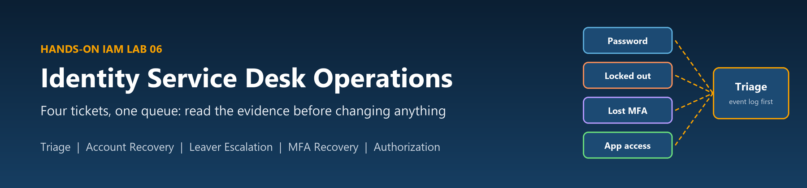
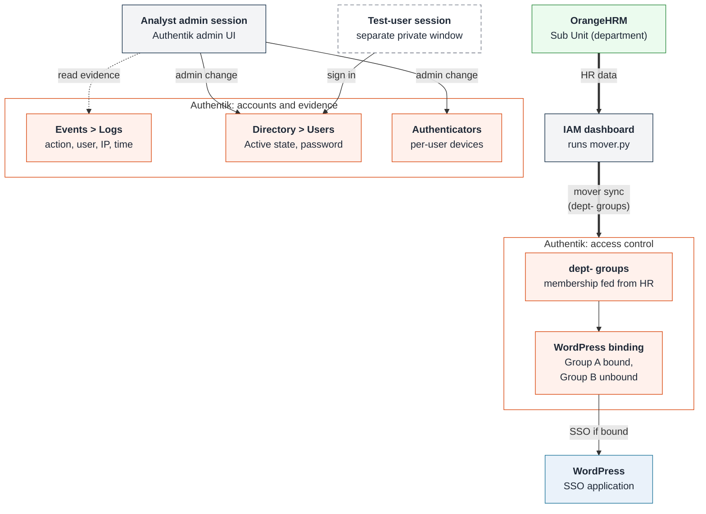
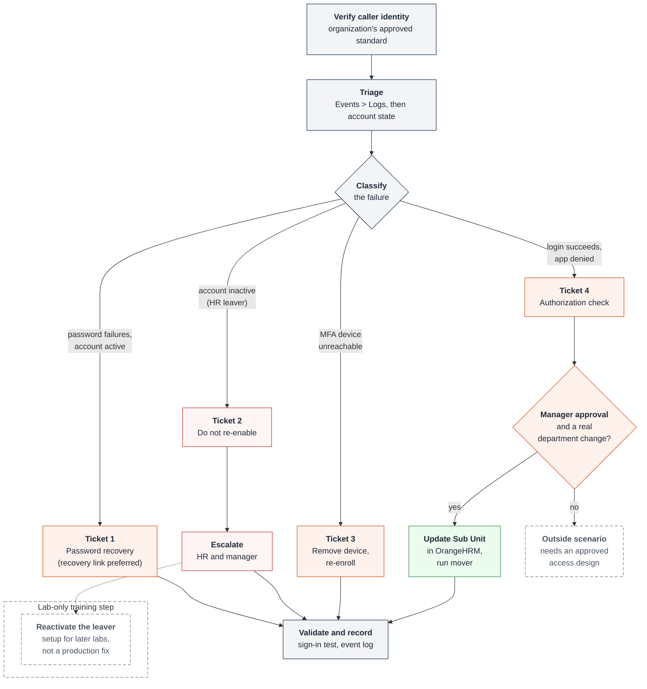

# Lab 06: Identity Service Desk Operations

  

  <strong>Professional Lab Documentation | Identity & Access Management / Identity Operations</strong>

  
  
  
  
  

---

## Table of Contents

1. [Project Overview](#project-overview)
2. [Objectives](#objectives)
3. [Scenario / Business Context](#scenario-business-context)
4. [Technologies & Tools](#technologies-tools)
5. [Architecture / Workflow](#architecture-workflow)
6. [Implementation / Steps Performed](#implementation-steps)
7. [Key Findings / Results](#key-findings-results)
8. [Skills Demonstrated](#skills-demonstrated)
9. [Screenshots & Evidence](#screenshots-evidence)
10. [Real-World Relevance](#real-world-relevance)
11. [Summary](#summary)
12. [Disclaimer](#disclaimer)

---

## :pushpin: Project Overview

This lab covers the operational side of identity and access management: working a service desk queue in which four tickets all reduce to "I can't log in", but each has a different cause. The environment is the one built in the earlier labs of the series: **Authentik** as the identity provider, **OrangeHRM** as the HR source of truth, and **WordPress** as an application behind Authentik single sign-on.

The guide describes the core skill as classification rather than button-pushing. Two of the four tickets should not be resolved the way the user asks: one is a deactivated leaver account that must not be re-enabled at the service desk, and one is not an authentication problem at all.

**Main objective:** start every ticket from evidence, classify the failure correctly, fix it at the layer where it actually lives, and recognize which requests are outside the service desk's authority.

> **Evidence scope.** This documentation is based on the training guide *Hands-On IAM Labs – Lab 6: Identity Service Desk Operations* by **Andrew, All Things Identity** (14 pages). The guide does not state a guide version, software versions or a capture date. It contains written instructions, checkpoints, callouts and a troubleshooting table, but **no screenshots, numbered figures or recorded test results**, so none are included here. This package documents what **the guide describes**, the **expected behavior** at each step and the **intended outcome** of each ticket. It is **not** evidence that the portfolio owner personally performed the lab, and no ticket outcomes, test results or account changes are claimed. Page references point to the source PDF.

### Lab Environment (from the source guide)

| Component | Details |
|---|---|
| Identity provider | Authentik (version not stated; the guide warns that menu labels move between releases) |
| HR source of truth | OrangeHRM, feeding `dept-` groups through the Lab 1 scripts |
| Application | WordPress, federated to Authentik (Lab 3) and gated on group membership (Lab 4) |
| Automation | `mover.py`, run from the IAM dashboard (from Lab 1) |
| Transport | Plain HTTP by design (lab only; the guide notes production systems always use HTTPS) |
| Access required | Authentik admin access, from the URL in the learner's welcome email |

**Prerequisites listed in the guide (p. 2):** Lab 1 (accounts provisioned from OrangeHRM, and at least one deactivated leaver), Lab 2 (at least one account with an MFA authenticator enrolled), Lab 3 (WordPress SSO working) and Lab 4 (WordPress gated on group membership).

---

## :dart: Objectives

The guide's stated learning objectives (pp. 1–2) are to:

- Read the identity provider's event log to establish what happened before changing anything
- Reset a password, and explain why admin-set passwords are the worse of the two options
- Distinguish a locked-out account from a deliberately deactivated one, and handle each correctly
- Remove and re-enroll a lost MFA authenticator without weakening the account
- Tell an authentication failure apart from an authorization failure
- Verify a caller's identity before handing them access

---

## :office: Scenario / Business Context

The guide does not describe a specific organization. Its framing is that the first IAM job most people get is not designing a role model but working a queue, where tickets that all say "I can't log in" have different causes and picking the wrong fix is either useless or dangerous (p. 1).

The guide stresses that **the user's description is not the diagnosis** (p. 3). Users report symptoms in the vocabulary they have; "I'm locked out", "it says wrong password" and "the page won't load" are often said about problems that are none of those.

### The four tickets

| Ticket | What the user says | What the guide says it actually is | Service desk's role |
|---|---|---|---|
| 1 | "I forgot my password" | A genuine password problem on a healthy account | Restore access through a credential reset |
| 2 | "I'm locked out" | An account deactivated after an HR termination | **Do not re-enable**; escalate to HR and the account owner's manager |
| 3 | "I lost my phone and I can't do MFA" | An unreachable authenticator device | Remove the stale device and re-enroll, keeping MFA enforced |
| 4 | "I can't get into WordPress" | An authorization failure; authentication succeeded | Fix group membership at its source, after a business approval |

### Verifying the caller ("Ticket zero")

Before any ticket, the guide says a real analyst confirms the caller is who they claim to be (p. 4). Password resets and MFA removals are described as the two most reliably abused service desk requests. In the lab the learner plays both parties, so there is nobody to verify; in production the analyst must **follow the organization's approved verification standard**. The guide does not define that standard, and this documentation does not invent one. It also advises treating urgency ("my manager is waiting") as a reason to slow down.

---

## :hammer_and_wrench: Technologies & Tools

| Technology / Tool | Purpose in this lab |
|---|---|
| **Authentik** Events > Logs | Event log for triage: action, user, client IP and timestamp for successful and failed logins |
| **Authentik** Directory > Users | Account state (Active flag), password action and the per-user list of authenticator devices |
| **Authentik** Directory > Groups | `dept-` group membership; also used for the tile-cache workaround in Ticket 4 |
| **Authentik** application bindings | WordPress is bound to Group A; Group B is deliberately unbound (from Lab 4) |
| **OrangeHRM** PIM > Job tab | Sub Unit (department), the source of `dept-` group membership |
| **IAM dashboard** with `mover.py` | Lab 1 mover script that keeps each `dept-` group matching HR |
| **WordPress** | The application the Ticket 4 user cannot reach |
| Private / incognito browser window | Test-user session, kept separate so the admin session stays signed in |

**Menu labels move between versions (p. 2).** The guide warns that Authentik renames admin sections between releases. If *Events > Logs* is not where the guide says, the learner looks for anything named Events, Logs or Audit. Password and authenticator actions are also described as version-dependent.

---

## :building_construction: Architecture / Workflow

Both diagrams below are written in Mermaid inside this README, so GitHub draws them directly. To change a label, box or arrow, edit the text in the `mermaid` code block.

### Architecture

Image version of this diagram: [`assets/architecture.png`](assets/architecture.png)

The diagram separates three kinds of relationship:

- **Evidence reading (dotted arrow):** the analyst reads Events > Logs before changing anything. The event log is one source of evidence; for Ticket 2 the account's Active state in Directory > Users carries a fact the log does not.
- **Admin changes (solid arrows):** password actions and authenticator removal are made on the user's page in Directory > Users. In the guide these are lab exercises; in production they follow caller verification and the organization's procedures.
- **HR membership path (thick arrows):** `dept-` group membership comes from the department recorded in OrangeHRM, applied by the mover script. Access to WordPress follows from group membership and the application's binding. There is **no direct path from HR to WordPress**, and there is no manual group edit on this path.

The test-user session runs in a separate private window so the learner can sign in as a test user without ending the admin session.

### Ticket workflow

Image version of this diagram: [`assets/workflow.png`](assets/workflow.png)

Every ticket starts with caller verification and triage, then branches by classification. The production response to Ticket 2 is escalation. The guide's reactivation of the leaver is drawn separately, with a dotted line, because it is a **lab-only training step** that restores the account for later labs and is not a resolution of the ticket.

---

## :gear: Implementation / Steps Performed

The steps below follow the five sections of the source guide and describe what the guide instructs and the expected behavior at each checkpoint. They are not a record of steps performed by the portfolio owner. Key decisions are shown inline; the guide's step-by-step instructions are in expandable sections.

### Section 01: Triage before you touch anything

**Goal (p. 2):** learn to read the event log, so every ticket starts with evidence instead of the user's theory.

**Step A: Find the log (p. 3).** In the Authentik admin interface, **Events > Logs** lists both failed and successful logins. The columns the guide points to are **action, user, client IP and timestamp**. The learner filters or searches for one of the Lab 1 users and reads their recent activity.

**Step B: Generate a failure and find it (p. 3).** In a **private or incognito window**, so the admin session stays signed in, the learner attempts to sign in as a test user with a deliberately wrong password **twice**, then refreshes Events > Logs and finds both failed attempts: which user, which IP and what the action is called.

<strong>Guide steps:</strong> Section 01 (p. 3)

| Step | Instruction (summarized) |
|---|---|
| A1 | Open the Authentik URL from the welcome email and sign in to the admin interface |
| A2 | Navigate to Events > Logs |
| A3 | Review the available columns (action, user, client IP, timestamp); failed and successful logins both appear |
| A4 | Filter or search for one Lab 1 user and read their recent activity |
| B1 | Open a private or incognito window |
| B2 | Attempt to sign in as a test user with a deliberately wrong password, twice |
| B3 | Return to the admin window and refresh Events > Logs |
| B4 | Find the two failed attempts and read the user, IP and action recorded |

**Checkpoint 1 (p. 3), expected behavior:** a specific failed login for a named user can be located and told apart from a successful one. If the two deliberate failures are not visible, the guide says to check that the view is **Events rather than System Tasks**; tasks are background jobs, not user activity.

**Limits of the log.** The log records what happened, not always why. Ticket 2 below is the guide's example: the event log reports a password failure for an account whose real problem is its state (pp. 7–8).

### Section 02: Ticket 1, "I forgot my password"

**Goal (p. 4):** restore access without the analyst knowing the user's password. (See the source inconsistency noted at the end of this section.)

**Step A: Check the log first (p. 4).** In Events > Logs, find the user's recent failed logins and confirm they are password failures against an account that is otherwise healthy, **not a disabled account**, which is Ticket 2's problem.

**Step B: Reset the credential (pp. 4–5).** In **Directory > Users**, open the user. The guide notes the password action is version-dependent: it may be labelled *Set password* or *Update password*, or sit behind a menu on the user's page.

| Option | Guide's position |
|---|---|
| Recovery link sent to the user | **Preferred.** The user sets a secret the analyst never learns (p. 5) |
| Force a change at next login | Use if the build offers it (p. 4) |
| Admin-set password | Second-best. On a fresh lab the user page reports that the brand has no recovery flow, so recovery links cannot be created and the guide falls back to *Set password* (pp. 4–5) |

The guide's reasoning (p. 5): a password the analyst types exists in two heads and often in a chat message, the ticket or the user's notes. Passwords must never be stored or shared in tickets, chat or documentation.

**Step C: Verify in the target system (p. 5).** In the private window, sign in as the user, confirm the user dashboard loads, then refresh Events > Logs and confirm the successful login is recorded.

<strong>Guide steps:</strong> Ticket 1 (pp. 4–5)

| Step | Instruction (summarized) |
|---|---|
| A1 | In Events > Logs, find the user's recent failed logins |
| A2 | Confirm they are password failures against an otherwise healthy account, not a disabled one |
| B1 | Open the user in Directory > Users |
| B2 | Find the password action (label varies by version) |
| B3 | Set a new password |
| B4 | Look for a forced-change option or a recovery link; prefer the recovery link if available. On a fresh lab there is no recovery flow, so *Set password* is used |
| C1 | In the private window, sign in as the user with the new credential |
| C2 | Confirm the user dashboard is reached |
| C3 | In admin, refresh Events > Logs and confirm the successful login is recorded |

**Checkpoint 2 (p. 5), expected behavior:** the user can sign in and the event log shows the successful login following the failures. If sign-in still fails with the new password, the guide says the ticket is really Ticket 2.

> **Source inconsistency recorded for client review.** The section goal (p. 4) and the testing checklist (p. 12) describe the user signing in with a credential the analyst **never learned**. The lab's fallback, however, has the analyst **set the password directly** because no recovery flow exists (pp. 4–5). Following the guide as written therefore does not meet its own goal. This documentation does not claim an analyst-unknown password; the intended outcome is met only where a recovery flow (or an equivalent user-set credential) is available.

### Section 03: Ticket 2, "I'm locked out"

**Goal (p. 6):** tell a lockout apart from a deactivation, and handle the deactivation as the security event it is.

| | Lockout | Deactivation |
|---|---|---|
| Cause | Automatic, for example too many bad passwords | Deliberate decision, here an HR termination (Lab 1 Leaver) |
| Duration | Temporary | Remains until someone with authority reverses it (the guide calls it permanent; it is not irreversible, since the account still exists and can be reactivated) |
| What the user sees | "I can't log in" | "I can't log in" |
| Service desk's role | Clearing it restores the status quo | Not the service desk's to grant; escalate |

**Step A: Use the leaver from Lab 1 (p. 6).** In Directory > Users, find the account the Lab 1 Leaver deactivated and confirm it shows as **inactive rather than deleted**. The guide notes the audit trail depends on the account continuing to exist.

**Step B: Attempt the login and read the failure (pp. 6–7).** Because the Lab 1 sync never gave the account a password, the guide has the learner set one on the inactive account (Authentik allows this) so the correct password is known for the test, then sign in as that user in the private window. The expected behavior is that the user is told the password is wrong, although it is correct. The learner then finds the attempt in Events > Logs and compares it with a genuine wrong-password failure from Section 01.

**Central finding (in the source environment, p. 7).** The guide reports that a correct password against a deactivated account produces `login_failed` with a `default-authentication-password` stage and a masked password field, **identical to a genuine wrong-password failure**. Nothing in the event says the account is inactive. The guide attributes this to the authentication backend returning "no user" for a disabled account exactly as for a bad password. The learner is asked to write down what they would have concluded had they trusted the log.

The missing fact is in **Directory > Users: the account's Active state**. The guide calls it the only place that carries this fact. This documentation does not claim the event log can identify deactivation; in the environment the guide describes, it cannot.

**Step C: Resolve the ticket correctly (pp. 7–8).**

| Response | What the guide describes |
|---|---|
| **Production response** | Do not re-enable the account. The account was deactivated by an HR termination, re-enabling it would restore access to someone the business has separated from, and the request goes back to **HR and the account owner's manager** rather than being resolved at the service desk |
| **Lab-only training step** | The guide then has the learner reactivate the account (Directory > Users > Activate > Activate User) because it is needed for later labs. This is a controlled lab step, not a production resolution, and it is not claimed as performed here |

The guide points out (p. 8) that nothing stopped the reactivation except a confirmation prompt: no reason, approval or alert. In production that is why re-enabling a disabled account should generate an alert someone reads, and why the control is the analyst knowing which requests are not theirs to grant. The Lab 7 guide, documented separately, builds its HR-reconciliation finding on this reactivated leaver.

<strong>Guide steps:</strong> Ticket 2 (pp. 6–8)

| Step | Instruction (summarized) |
|---|---|
| A1 | Navigate to Directory > Users |
| A2 | Find the account the Lab 1 Leaver deactivated |
| A3 | Confirm it is inactive rather than deleted |
| B1 | Set a password on the inactive account (it has none from the Lab 1 sync), then attempt to sign in as that user in the private window |
| B2 | Note the message: it says the password is wrong, not that the account is deactivated |
| B3 | Find the attempt in Events > Logs and read the action and context |
| B4 | Compare it with a genuine wrong-password failure from Section 01, field by field |
| B5 | Write down what would have been concluded from the log alone |
| C1 | Do not re-enable the account |
| C2 | Write down the correct production response: escalate to HR and the account owner's manager |
| C3 | Lab only: reactivate the account for the rest of the lab series, and note that only a confirmation prompt stood in the way |

**Checkpoint 3 (p. 8), expected behavior:** the learner can state the difference between a lockout and a deactivation, has confirmed the deactivated login attempt is indistinguishable in the log from an ordinary wrong-password failure, can name Directory > Users and the Active flag as the place that carries the answer, and wrote down the correct escalation **before** the lab-only reactivation.

### Section 04: Ticket 3, "I lost my phone and I can't do MFA"

**Goal (p. 8):** remove an unreachable authenticator and get the user re-enrolled, rather than turning MFA off.

**Step A: Find the enrolled authenticator (pp. 8–9).** Open the Lab 2 user in Directory > Users and find the section listing registered authenticator devices. The guide notes the label varies by version (*MFA Authenticators*, *Authenticator Devices*, or a tab on the page). Confirm the Lab 2 device is listed.

**Step B: Remove it and re-enroll (p. 9).** Delete the device the user can no longer reach. In the private window, signing in as the user is expected to prompt for enrollment of a new authenticator rather than letting the user straight in. Complete enrollment, then sign out and back in to confirm the **new** authenticator is the one challenged.

| Approach | Outcome described by the guide |
|---|---|
| Exempt the user from MFA | Closes the ticket fast but leaves an unprotected account behind; nobody comes back to re-enable it |
| Temporary exemption (if unavoidable) | Must have an **expiry** and a **note** (p. 9). The guide does not define an approval process, and none is invented here |
| Delete the stale device and re-enroll | Same few minutes for the user; the account stays protected. **This is the guide's intended fix** |

**Keep the policy in scope.** Deleting a device does not by itself guarantee re-enrollment in every configuration; it depends on the user remaining in scope of the policy that enforces MFA. The final sign-in is the check: if the user signs straight in with no MFA prompt, the guide says they have dropped out of the enforcing policy and the learner should re-check the Lab 2 MFA policy (pp. 9, 13).

Enrollment QR codes, setup seeds, recovery codes and credentials must never be captured in tickets, screenshots or documentation, and none are included here.

<strong>Guide steps:</strong> Ticket 3 (pp. 8–9)

| Step | Instruction (summarized) |
|---|---|
| A1 | Open the Lab 2 user in Directory > Users |
| A2 | Find the list of registered authenticator devices (label varies by version) |
| A3 | Confirm the Lab 2 device is listed |
| B1 | Delete the device the user can no longer reach |
| B2 | In the private window, sign in as the user; expect a prompt to enroll a new authenticator |
| B3 | Complete the enrollment |
| B4 | Sign out and back in to confirm the new authenticator is challenged |

**Checkpoint 4 (p. 9), expected behavior:** the old authenticator is gone, a new one is enrolled, and signing in as the user challenges for the new device.

### Section 05: Ticket 4, "I can't get into WordPress"

**Goal (p. 10):** recognize an authorization failure and fix it at the right layer.

**Step A: Reproduce it (p. 10).** In the private window, sign in to Authentik as a **Group B** member from Lab 4, the group deliberately not bound to WordPress. The expected behavior is that the user passes authentication in Authentik but cannot reach WordPress.

**Step B: Read what the log tells you (p. 10).** In Events > Logs the user's login succeeded; there is no authentication failure to find. The learner writes down the distinction:

- **Authentication** answers "are you who you say you are". This user passed it.
- **Authorization** answers "are you allowed to do this". That is what failed.

Password resets, MFA fixes and account unlocks are all authentication-side actions and would not help. The guide calls a password reset on an authorization problem the most common wasted action on an IAM service desk.

**Step C: Fix it at the right layer (pp. 11–12).**

1. **Decide whether the user should have access.** The guide says this is a question for the user's manager, not a decision the service desk makes alone.
2. **Find where the membership comes from.** Group A is a `dept-` group built from OrangeHRM by the Lab 1 scripts, so membership follows department.
3. **Assuming an approved, legitimate department change,** update the employee's **Sub Unit** in OrangeHRM (PIM > employee > Job tab > Save).
4. **Run the existing `mover.py`** from the IAM dashboard. The expected behavior is that the user is added to Group A's `dept-` group and removed from the old one. A second run is expected to print only "Mover done."
5. **Verify** in the private window that the WordPress tile appears and launches, and confirm on the Lab 4 bindings tab that **Group B is still unbound**.

HR data must never be changed to grant an entitlement. If the user needs WordPress access without a real department change, that is outside the scenario the guide describes and needs an approved access design rather than a falsified HR record.

| Shortcut | Why the guide rejects it |
|---|---|
| Add the user to Group A by hand (Directory > Groups) | Works immediately but does not last: the mover keeps every `dept-` group matching HR, so the next run may remove the user. Until it runs, the directory disagrees with HR, which is the kind of finding Lab 7 teaches reviewers to catch (p. 11) |
| Bind Group B to WordPress | Grants access to every current and future Group B member, none of whom were approved. The guide describes this as how environments drift into over-provisioning: "Move the person, not the fence" (p. 11) |
| Password reset or MFA change | Authentication-side actions; the failure is authorization (p. 10) |

**Tile visibility versus effective access (p. 11).** In the source environment, Authentik caches each user's application tile list for up to 24 hours, and neither a group change nor signing out and back in clears it. The guide states that access itself is already granted. Its workaround is to open the group in Directory > Groups, click **Edit**, save it without changes, and reload the user's dashboard. Tile visibility and whether WordPress actually admits the user are recorded as separate observations.

<strong>Guide steps:</strong> Ticket 4 (pp. 10–12)

| Step | Instruction (summarized) |
|---|---|
| A1 | In the private window, sign in as a Group B member from Lab 4 |
| A2 | Confirm the user authenticates to Authentik |
| A3 | Confirm the user cannot reach WordPress |
| B1 | In admin, open Events > Logs |
| B2 | Find the user's activity; the login succeeded and there is no authentication failure |
| B3 | Write down the authentication versus authorization distinction |
| C1 | Decide whether the user should have access; in a real queue this is the manager's decision |
| C2 | Assuming approval, find where Group A's membership comes from (department in OrangeHRM) |
| C3 | In OrangeHRM, change the employee's Sub Unit to Group A's subunit and save |
| C4 | In the IAM dashboard, run `mover.py`; expect the user added to Group A's `dept-` group and removed from the old one; a second run prints only "Mover done." |
| C5 | Sign the user out and back in and check the WordPress tile; refresh the tile cache by saving the group unchanged, then reload the dashboard |

**Checkpoint 5 (p. 12), expected behavior:** the user reaches WordPress through a department change in OrangeHRM and a mover run, not through a manual group edit or a new binding for Group B, and Lab 4's bindings tab shows Group B still unbound.

---

## :mag: Key Findings / Results

No ticket outcomes, test results or account changes are claimed in this documentation. The findings below are the lessons and expected behaviors **the guide describes**.

### Ticket comparison

| Ticket | Diagnostic evidence | Wrong fix | Intended outcome |
|---|---|---|---|
| 1. Forgotten password | Password failures in Events > Logs on an active account | Sharing a password through a ticket or chat | User regains access with a credential the analyst does not hold (recovery link where available); success visible in the log |
| 2. "Locked out" | Active state in Directory > Users; the log shows only `login_failed` | Treating it as a password reset and re-enabling a leaver | Account stays inactive; request escalated to HR and the manager |
| 3. Lost MFA device | Authenticator list on the user's page | Exempting the user from MFA indefinitely | Stale device removed, new device enrolled, MFA still challenged |
| 4. WordPress access | Successful login in the log; no WordPress access | Password reset, manual group edit, or binding Group B | Approved department change in HR, mover applied, Group B still unbound |

### Decision points

| Decision | Who decides (per the guide) | Service desk action |
|---|---|---|
| Is the caller who they claim to be? | The organization's verification standard | Verify before touching the account |
| Should a deactivated leaver regain access? | HR and the account owner's manager | Escalate; do not re-enable |
| Should a user be exempted from MFA? | Not defined in the guide | Avoid; any temporary exemption needs an expiry and a note |
| Should a user gain WordPress access? | The user's manager | Fix membership at its source after approval |

### Key insights

- **The event log is the starting point, not always the answer.** In the source environment a correct password against an inactive account produces the same `login_failed` event as a wrong password; the Active state supplies the missing fact.
- **A deactivation is a security event, not a lockout.** The system asked only for confirmation before reactivation, so the control is the analyst's judgment.
- **MFA recovery should not remove MFA.** Deleting the device and re-enrolling, with the enforcing policy still in scope, keeps the account protected.
- **Authorization problems are fixed at the authorization layer.** Group membership fed from HR is fixed in HR (after a legitimate change), not by editing the group or widening the binding.

<strong>Guide's testing checklist (p. 12) and status in this documentation</strong>

| Checklist item | Status in this documentation |
|---|---|
| Find a specific user's failed and successful logins in the event log | Method documented; not verified |
| Ticket 1: user signs in with a credential the analyst never learned, and the success is in the log | Method documented; conflicts with the lab's admin-set fallback (see Section 02) |
| Ticket 2: state the difference between a lockout and a deactivation | Documented |
| Ticket 2: confirm the event log cannot tell them apart and name Directory > Users as the tool that can | Documented as the guide's reported behavior; not verified |
| Ticket 2: write the correct escalation before reactivating the leaver for lab purposes | Escalation documented; reactivation not performed |
| Ticket 3: stale authenticator deleted and a new one enrolled | Method documented; not verified |
| Ticket 3: user still challenged for MFA, not exempted | Method documented; not verified |
| Ticket 4: identified as an authorization failure with no authentication failure in the log | Documented |
| Ticket 4: fixed by changing the department in OrangeHRM and running the mover; Group B still unbound | Method documented; not verified |

### Troubleshooting (from the guide, pp. 12–13)

| Symptom | Guide's likely cause and fix | Documentation note |
|---|---|---|
| Events log is empty | Looking at System Tasks (background jobs). Find Events or Logs and generate a failed login to confirm | |
| Password reset had no effect | The guide's stated cause is a deactivated account (Ticket 2) | Not proof of deactivation on its own; check the Active state in Directory > Users before touching the credential |
| No authenticator devices listed for a Lab 2 user | Lab 2 enrollment did not complete, or the wrong account is open. Confirm the username, then re-run Lab 2 enrollment | |
| User signs in with no MFA prompt after the device was deleted | User is out of scope of the MFA policy; deleting a device does not exempt a user, so something else changed. Re-check the Lab 2 MFA policy | |
| Group change made no difference | Tile list cached; edit the group and save unchanged, then reload. The guide states access works straight away | Applies to the source environment; record tile visibility and effective access separately |
| Ticket 4 user reaches WordPress with the wrong permissions | Authorization worked but role mapping did not; the guide refers to Lab 4 Section 04 and an exact group-name match | Depends on group-based role mapping configured in Lab 4. Whether the WordPress SAML plugin tier in use supports this, and how roles are configured, needs confirmation |
| The wrong account was reactivated | Deactivate it again in Directory > Users and re-run the Lab 1 Leaver; disabled accounts are not deleted, so no data is lost | Lab correction only |

---

## :brain: Skills Demonstrated

- Evidence-first triage: reading Events > Logs for action, user, client IP and timestamp before changing an account
- Recognizing the limits of a log and knowing which tool holds a given fact (account state versus event history)
- Credential recovery that minimizes analyst knowledge of the password, and recognizing when a lab fallback falls short of that goal
- Distinguishing a temporary lockout from an HR-driven deactivation and escalating instead of re-enabling
- MFA device recovery that keeps the enforcing policy in scope, without permanent exemptions
- Distinguishing authentication failures from authorization failures
- Fixing HR-driven group membership at its source and resisting over-provisioning shortcuts
- Recognizing social-engineering risk in service desk requests and the need for caller verification

---

## :camera_with_flash: Screenshots & Evidence

**No screenshots are included.** The source guide contains no screenshots or numbered figures, and none have been created or substituted. The rendered PDF pages are not presented as screenshots.

A completed run of the lab would produce evidence at each checkpoint. The table lists what each checkpoint relies on, as a guide for any client-supplied evidence. None of it is included here.

| Checkpoint | Evidence a completed run would rely on | Handling notes |
|---|---|---|
| 1. Triage (p. 3) | Failed and successful login events for a named test user | Mask client IPs if not lab-only |
| 2. Ticket 1 (p. 5) | Successful login event following the failures | Never capture the password |
| 3. Ticket 2 (p. 8) | Inactive state in Directory > Users; the `login_failed` event; the written escalation | No real employee data |
| 4. Ticket 3 (p. 9) | Authenticator list before and after; MFA challenge on sign-in | Never capture QR codes, seeds or recovery codes |
| 5. Ticket 4 (p. 12) | Mover output; group membership; bindings tab with Group B unbound; WordPress access | Record tile visibility and effective access separately |

### Source page reference

| Content | Source pages |
|---|---|
| Title, author, why the lab matters, objectives | 1–2 |
| Prerequisites, HTTP note, menu-label callout | 2 |
| Section 01: triage, Checkpoint 1 | 2–3 |
| Ticket zero: caller verification | 4 |
| Section 02: Ticket 1, recovery-link callout, Checkpoint 2 | 4–5 |
| Section 03: Ticket 2, log callout, reactivation callout, Checkpoint 3 | 6–8 |
| Section 04: Ticket 3, failure-mode callout, Checkpoint 4 | 8–9 |
| Section 05: Ticket 4, authorization callouts, tile cache, Checkpoint 5 | 10–12 |
| Testing checklist | 12 |
| Troubleshooting | 12–13 |
| Interview talk track | 13 |
| Wrap-up | 14 |

The source file, checksum, page references and diagram export details are recorded in [`docs/evidence-manifest.json`](docs/evidence-manifest.json). Open questions for the client are in [`docs/CLIENT-REVIEW.md`](docs/CLIENT-REVIEW.md).

---

## :briefcase: Real-World Relevance

- **Social engineering at the service desk:** the guide notes that password resets and MFA removals are the most reliably abused service desk requests, and that several large breaches began with a convincing phone call. Caller verification and resistance to urgency are core controls.
- **Leaver controls:** re-enabling a terminated employee's account undoes an HR decision. Escalation to HR and the manager, and alerting on reactivation, keep the leaver process intact.
- **MFA lifecycle:** lost-device tickets are routine. Recovering by re-enrollment rather than by exemption avoids accounts that silently lose protection.
- **Least privilege:** fixing one ticket by widening an application binding is how over-provisioning accumulates. Fixing membership at its HR source keeps access aligned with the role.
- **Vendor-neutral pattern:** the guide's wrap-up (p. 14) notes that the same pattern (read the log, classify the failure, fix it at the right layer, know which requests are above your authority) applies in Authentik, Entra ID, Okta or Ping.

The guide closes with a first-person interview talk track for learners (p. 13). It is the guide's suggested framing for someone who has completed the lab, not a statement by the portfolio owner, and it is not reproduced as one here.

---

## :memo: Summary

This lab documents four service desk tickets that each present as "I can't log in": a forgotten password, a deactivated leaver, a lost MFA device and an authorization failure. Following the source guide, each ticket starts with caller verification and the event log, then is classified and handled at the right layer: a credential reset that prefers a recovery link, an escalation to HR and the manager instead of re-enabling a leaver, MFA re-enrollment that keeps the policy in place, and a department change in HR applied by the mover instead of a manual group edit or a wider binding.

The guide's intended outcome is an analyst who reads evidence before acting, knows the limits of each tool, and recognizes which requests are not theirs to grant. The guide contains instructions and expected behavior only; ticket outcomes and test results from the portfolio owner's own environment are not part of this documentation.

---

## :warning: Disclaimer

This project is documented for educational and portfolio purposes. The lab design and instructions are from *Hands-On IAM Labs – Lab 6: Identity Service Desk Operations* by Andrew, All Things Identity, and remain the property of their author. No passwords, enrollment QR codes, seeds, recovery codes, tokens or live identity data are included. No lab infrastructure was accessed or changed in preparing this documentation: no credentials were reset, no accounts were changed or reactivated, no MFA devices were removed and `mover.py` was not run.

---

  <strong>Created as part of a professional cybersecurity and IAM portfolio.</strong>

